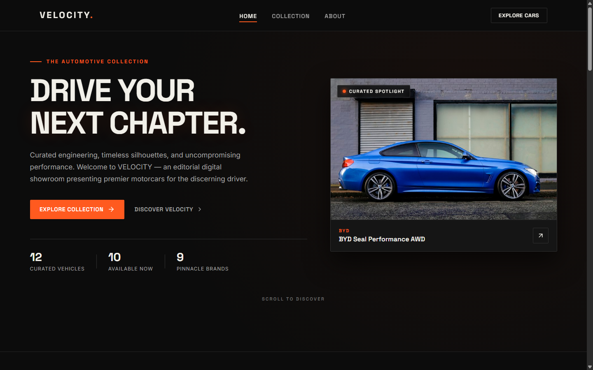

# VELOCITY — Premium Automotive Digital Showroom



> **BTNG Frontend Final Project**  
> An editorial, responsive digital showroom presenting curated high-performance motorcars powered by live REST API integration. Built strictly with standard **HTML5**, **CSS3**, and **Vanilla JavaScript** — without any external frameworks or UI libraries.

---

## 🏎️ Brand & Editorial Concept

- **Brand Name:** VELOCITY
- **Brand Personality:** Premium, Modern, Bold, Minimalist, Editorial, Professional.
- **Concept:** A curated automotive discovery experience where engineering discipline meets editorial clarity. Built as an academic concept showroom for the BTNG Frontend Final Project.

### Color Palette
| Color | Hex | Usage |
| :--- | :--- | :--- |
| **Deep Black** | `#0C0C0C` | Primary background, high-contrast canvas |
| **Charcoal Black** | `#151515` | Surface cards, elevated controls, containers |
| **Warm Ivory** | `#F2F0E9` | Headlines, primary text, high-legibility content |
| **Muted Gray** | `#A3A3A3` | Secondary text, specifications, labels |
| **Racing Orange** | `#FF5A1F` | Accent buttons, active indicators, brand dot |
| **Subtle Border** | `#303030` | Precision dividers, card borders, focus rings |

### Typography
- **Display & Headings:** `Space Grotesk` (with `-apple-system, BlinkMacSystemFont, "Segoe UI", Roboto` fallbacks).
- **Body & Specifications:** `Inter` (with clean sans-serif system fallbacks).

---

## ⚡ Key Features

1. **Live REST API Integration:**
   - Real-time catalog retrieval from the official BTNG API endpoint:  
     `https://api-web.dnccudinus.org/api/mobil`
   - Validates HTTP status, JSON payload `success` property, and array schema.
   - Dynamic inventory calculation for Total Vehicles, Available Count, and Unique Brands.

2. **Cinematic Hero Showcase:**
   - Editorial headline and mission statement.
   - Live metrics bar dynamically derived from the API response.
   - Featured vehicle spotlight automatically populated from catalog data with graceful fallback.

3. **Dynamic Vehicle Catalog & Controls:**
   - **Search Input:** Real-time search across vehicle name and brand with instant clear button.
   - **Dynamic Brand Filter:** Populated automatically from actual brands present in API data.
   - **Dynamic Fuel Filter:** Populated automatically from fuel types present in API data.
   - **Sorting Engine:** Price (Lowest first), Price (Highest first), Year (Newest first), and Name (A–Z).
   - **Filter Status & Reset:** Displays visible vs. total count, active filter chips with removal actions, and instant reset.

4. **Dynamic Vehicle Cards:**
   - Rendered using safe DOM methods (`document.createElement`, `textContent`).
   - Prices formatted in Indonesian Rupiah using native `Intl.NumberFormat('id-ID', ...)`.
   - Specifications for Transmission, Fuel Architecture, Year, and Status badge (`TERSEDIA` / `TERJUAL`).
   - Graceful image fallback handling to prevent broken images and infinite error loops.

5. **Accessible Vehicle Detail Modal (`<dialog>`):**
   - Implemented using native `<dialog closedby="any">` following modern web standards.
   - Complete specifications: Brand Origin, Manufacturing Year, Transmission, Fuel, Valuation, Status, and Catalog ID.
   - Accessible keyboard controls (`Escape` dismissal, focus trapping, and light-dismiss backdrop click fallback).
   - Simulated vehicle inquiry feedback toast.

6. **Responsive & Accessible Design:**
   - Fully fluid desktop, tablet, and mobile layouts via CSS Grid and Flexbox.
   - Mobile navigation drawer with hamburger toggle and auto-close on selection.
   - Tested for visible keyboard focus (`:focus-visible`) and `prefers-reduced-motion` compliance.

---

## 📁 Project Structure

```
d:/Projek baru BTNG/
│
├── index.html                    # Semantic HTML5 single-page structure
├── css/
│   └── style.css                 # Custom CSS3 editorial dark design system
├── js/
│   └── app.js                    # Vanilla JS API fetch, DOM rendering & filter logic
├── assets/
│   └── images/
│       ├── fallback-car.svg      # Editorial automotive SVG fallback placeholder
│       ├── favicon.svg           # Custom SVG brand favicon
│       ├── preview-hero.png      # Hero showcase preview screenshot
│       ├── preview-collection.png# Collection grid preview screenshot
│       └── preview-modal.png     # Vehicle detail modal preview screenshot
└── README.md                     # Documentation & submission guidelines
```

---

## 🚀 How to Run Locally

Because this project uses vanilla HTML, CSS, and JavaScript with the browser `fetch()` API, it is recommended to run it through a local HTTP server to avoid local file CORS restrictions:

### Option A: VS Code Live Server (Recommended)
1. Open the project folder in **Visual Studio Code**.
2. Install the **Live Server** extension (by Ritwick Dey) if not already installed.
3. Right-click `index.html` and click **"Open with Live Server"**.
4. The showroom will launch automatically at `http://127.0.0.1:5500`.

### Option B: Node.js `npx serve`
In your terminal, navigate to the project directory and run:
```bash
npx serve .
```
Open `http://localhost:3000` in your browser.

### Option C: Python Built-in HTTP Server
If Python is installed:
```bash
# Python 3
python -m http.server 8000
```
Open `http://localhost:8000` in your browser.

---

## 🧪 Testing Checklist & Verification

Automated browser integration tests were executed via headless Chrome DevTools Protocol (CDP) and verified the following:

- [x] **Page Load:** Header, navigation, hero, collection, about, and footer render without errors.
- [x] **API Connectivity:** Data retrieved from `https://api-web.dnccudinus.org/api/mobil`.
- [x] **Dynamic Rendering:** 12 vehicle cards populated from the live API response.
- [x] **Currency Formatting:** Indonesian Rupiah formatted correctly (e.g., `Rp 719.000.000`).
- [x] **Live Counters:** Dynamic count updates (12 Total, 10 Available, 2 Sold, 9 Brands).
- [x] **Search Filtering:** Searching for "Civic" correctly isolates the Honda Civic card and updates counters.
- [x] **Brand & Fuel Filtering:** Selecting "Toyota" and fuel types updates the view dynamically.
- [x] **Sorting Engine:** Lowest and Highest price sorting orders verify accurate numeric price sorting.
- [x] **Filter Reset:** Restores full showroom inventory in a single click.
- [x] **Empty State:** Non-matching search displays helpful empty state message and a reset action.
- [x] **Detail Modal:** Opens on "View Details", displays full specifications, handles Esc key, close button, and backdrop click.
- [x] **Image Handling:** API images load with 16:10 aspect ratio; fallback SVG prevents broken UI if network fails.
- [x] **Mobile Responsiveness:** Navigation drawer opens and closes properly on mobile viewport.
- [x] **Zero Console Errors:** Clean execution without uncaught exceptions.

---

## 📤 Steps to Publish to GitHub for Final Project Submission

Repository naming format required for BTNG:  
`BTNG-Frontend-NamaLengkap` (Replace `NamaLengkap` with your full name, e.g., `BTNG-Frontend-BayuAji`)

1. **Initialize Git Repository:**
   ```bash
   git init
   git add .
   git commit -m "feat: complete VELOCITY automotive digital showroom for BTNG final project"
   ```

2. **Create New Public Repository on GitHub:**
   - Log in to your GitHub account.
   - Click **New Repository**.
   - Repository name: `BTNG-Frontend-NamaLengkap`
   - Set visibility to **Public**.
   - Do **not** initialize with a new README (since we already have one).

3. **Link Remote and Push:**
   ```bash
   git branch -M main
   git remote add origin https://github.com/<your-username>/BTNG-Frontend-NamaLengkap.git
   git push -u origin main
   ```

4. **Enable GitHub Pages (Optional for Live Demo):**
   - Go to your repository settings on GitHub: **Settings > Pages**.
   - Under **Build and deployment > Source**, select **Deploy from a branch**.
   - Select Branch: `main` / `root`, then click **Save**.
   - Your live showroom website will be accessible online within minutes.

---

## 📜 Academic Disclaimer
This project is developed solely as an educational frontend final project for the **BTNG** program. VELOCITY is a concept digital showroom and does not represent an actual dealership, commercial vehicle retailer, or official distributor. All vehicle data and images are dynamically sourced through the official BTNG REST API.
# BTNG-Frontend-BayuAjiPanenggar

